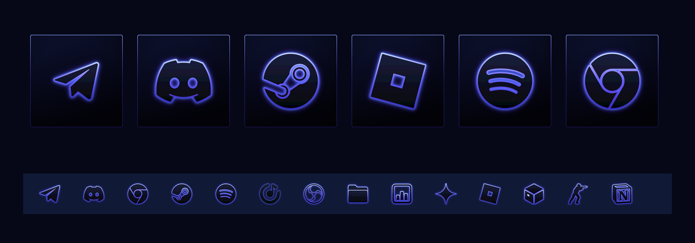
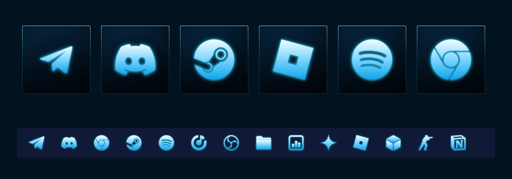
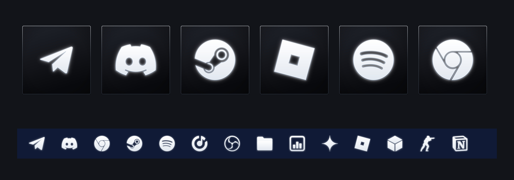
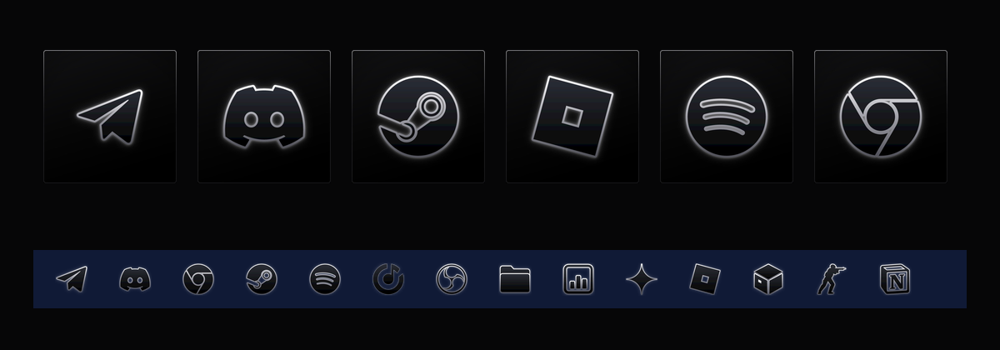
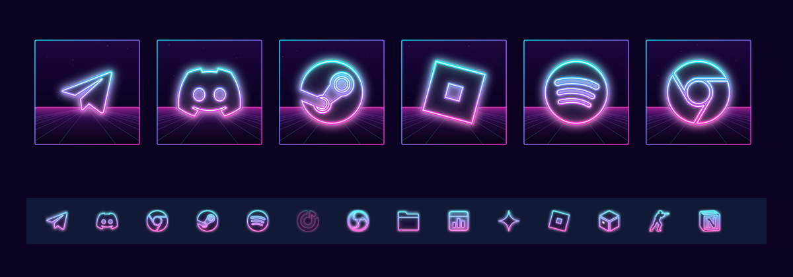
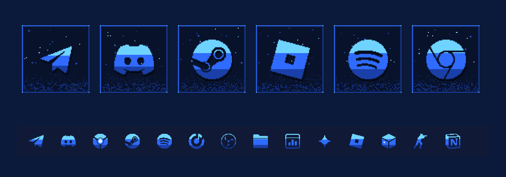
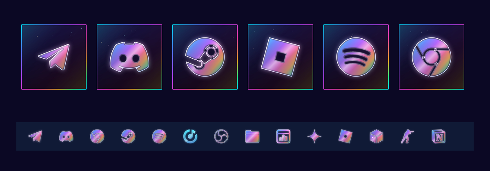
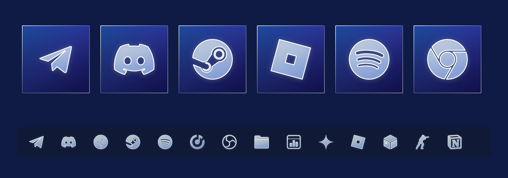
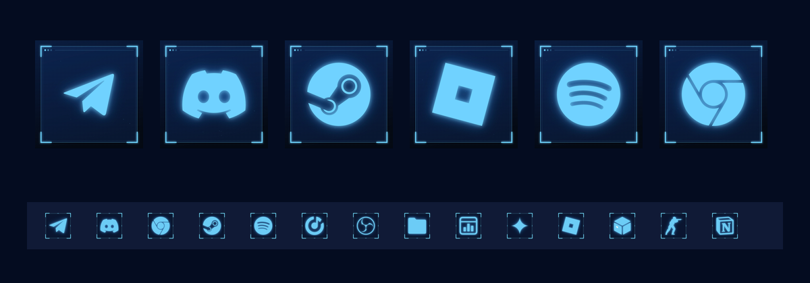
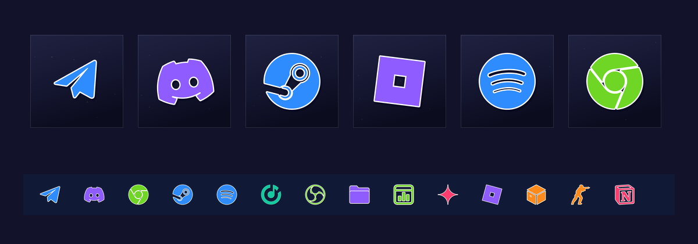

<p align="center"></p>

<h1 align="center">Glyphix</h1>
<p align="center">Паки иконок для панели задач, ярлыков и плиток Start11 в Windows — в один клик.<br>
<i>One-click icon packs for the Windows taskbar, shortcuts and Start11 tiles.</i></p>

<p align="center"></p>

## Что это

Как паки иконок на Android, только для Windows 10/11. Выбираешь пак — Glyphix сам находит твои приложения
(закреплённые на панели задач, ярлыки на рабочем столе и в «Пуске», плитки **Start11**) и ставит им иконки из пака.

- **Один клик:** «Применить» — и всё. «Откатить всё» возвращает исходные иконки и плитки.
- **11 стилей по 217 иконок:** Shadow, Azure, White, Black, Neon, Pixel, Gold, Holo, Glass, System, Sticker — мессенджеры, браузеры, игры и лаунчеры
  (Steam, Roblox, Minecraft, Epic, Riot, Battle.net, CS2, Dota 2…), музыка, системные приложения, работа и творчество.
- **Плитки Start11:** если установлен Start11, плитки ставятся автоматически (с подписью или без).
- **Автоиконки:** приложениям, для которых в паке нет иконки, Glyphix сам перекрашивает их родную иконку в стиль пака (локально, без сети; нужен `auto.json` в паке). Для каждого приложения можно выбрать «Авто / Родная / Не трогать»; общий выключатель — галочка внизу окна.
- **Обновления без архивов:** «Обновить паки» докачивает новое из этого репозитория.
- **Ничего в фоне:** нет автозапуска, служб и задач планировщика.
- **Безопасно:** при обновлении скачиваются только картинки (`.png`/`.ico`) и описания паков (`.json`),
  каждый файл сверяется по SHA-256. Код открыт.

## Установка

Открой **PowerShell** (Win+X → «Терминал» / «Windows PowerShell») и вставь:

```powershell
irm https://raw.githubusercontent.com/F1KS-FK/glyphix/main/install.ps1 | iex
```

Появится ярлык **Glyphix** на рабочем столе и в «Пуске». Удаление: в приложении «⋯» → «Удалить приложение»
(перед этим иконки и плитки вернутся к исходным).

## Паки

| | |
|---|---|
| **Shadow** | **Azure** |
|  |  |
| **White** | **Black** |
|  |  |
| **Neon** | **Pixel** |
|  |  |
| **Gold** | **Holo** |
|  |  |
| **Glass** | **System** |
|  |  |
| **Sticker** | |
|  | |

Нет иконки для твоего приложения? Открой issue с названием приложения.

## Ограничения

- Приложения из Microsoft Store (UWP) на панели задач этим способом не меняются (в Start11 — меняются).
- Общие для всех пользователей ярлыки меняются с галочкой «Также общие ярлыки» (попросит права администратора).
- Discord, Chrome и др. при обновлении могут пересоздать свои ярлыки — просто нажми «Применить» ещё раз.

## Автор

by **F1KS** · Telegram [@Im_Flawless](https://t.me/Im_Flawless)

## Лицензия

- Код: **GPL-3.0** © 2026 F1KS — можно использовать и менять, но производные проекты остаются открытыми и указывают автора.
- Иконки: **CC BY-NC-SA 4.0** © 2026 F1KS — бесплатно, с указанием автора, без продажи. См. [packs/LICENSE.md](packs/LICENSE.md).
- Логотипы сторонних приложений — товарные знаки их владельцев; часть иконок основана на [Simple Icons](https://simpleicons.org) (CC0).
  Иконки — фан-перерисовка для личной кастомизации, проект не связан с правообладателями.

---

### English

**Glyphix** applies icon packs (11 styles: Shadow, Azure, White, Black, Neon, Pixel, Gold, Holo, Glass, System, Sticker — 217 icons each) to Windows 10/11 taskbar pins, shortcuts and
Start11 tiles in one click, with undo and in-app updates. No background processes. Install:
`irm https://raw.githubusercontent.com/F1KS-FK/glyphix/main/install.ps1 | iex`.
Code: GPL-3.0, icons: CC BY-NC-SA 4.0, © 2026 F1KS.
